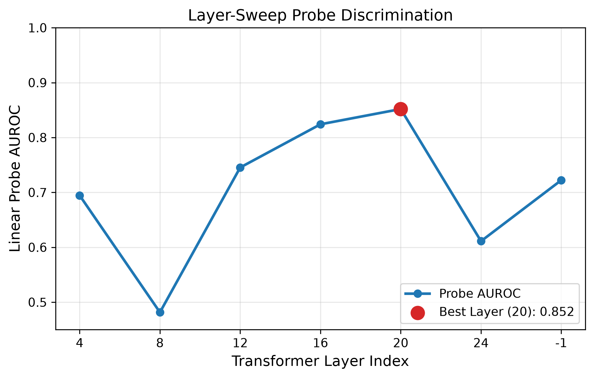
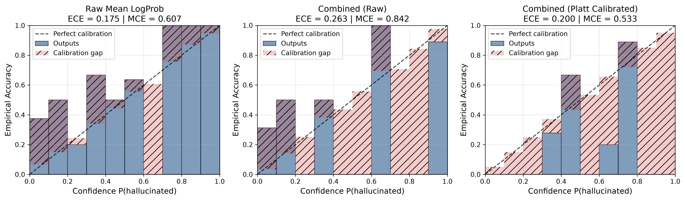
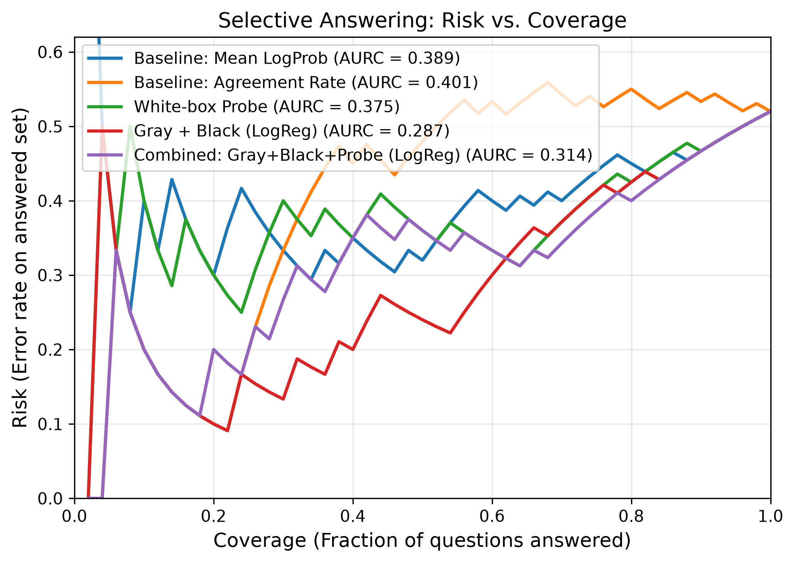
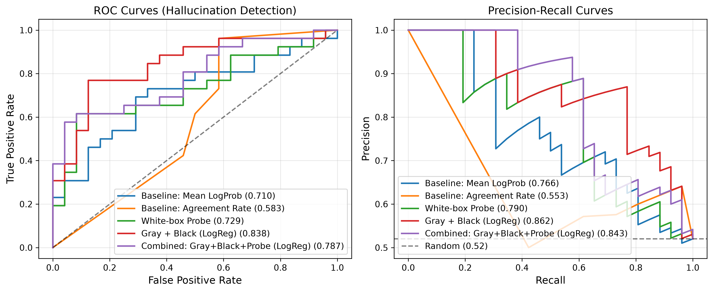
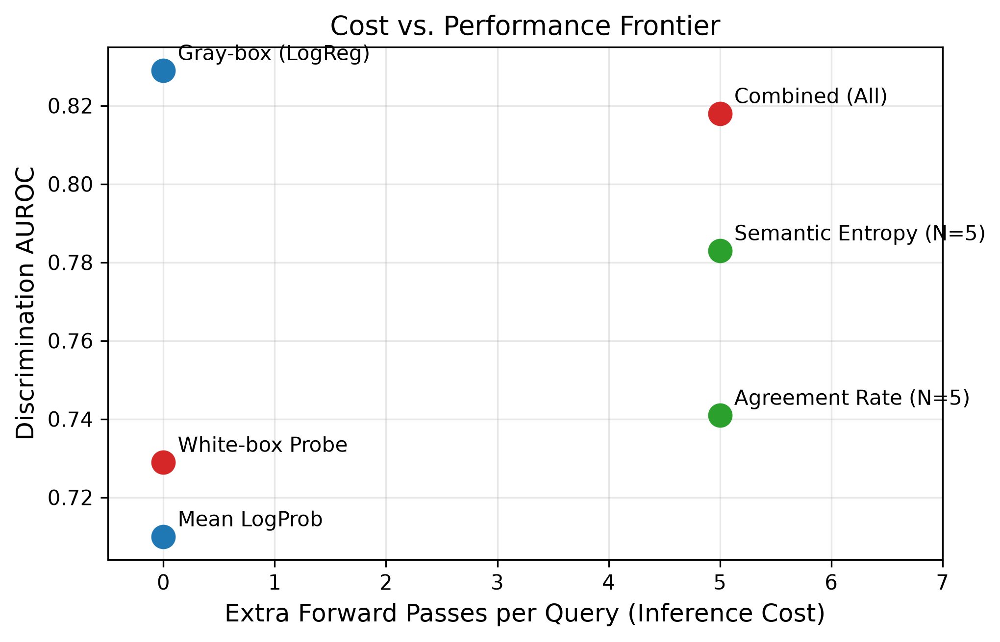

# Calibrated Hallucination Detection in LLMs via Internal Uncertainty Signals

A trained detector that predicts, **without ground truth at inference time**, whether an open-weight LLM's answer is likely hallucinated. It combines black-box signals (self-consistency, semantic entropy), gray-box signals (token log-probs, entropy), and white-box signals (hidden-state probe), then outputs a **calibrated probability** that the answer is wrong.

---

## 1. Problem

LLMs state wrong answers as confidently as right ones. Any RAG system, agent, or chatbot needs a cheap signal for "don't trust this answer." Raw model confidence (token probability) is poorly calibrated, so we learn a better one.

**Goal:** given `(question, generated_answer)` plus signals extracted during generation, output `P(hallucinated)`, and make that probability *honest* (when it says 0.8, it is wrong about 80% of the time).

## 2. Honest positioning

This is **not a new problem**. Prior art you must read and cite:
- *SelfCheckGPT* (self-consistency for hallucination detection)
- *Semantic Entropy* (Kuhn et al. 2023; Farquhar et al. 2024, Nature)
- *Language Models (Mostly) Know What They Know* (Kadavath et al. 2022)
- *The Internal State of an LLM Knows When It's Lying* (Azaria & Mitchell 2023)
- Calibration: Guo et al. 2017 (temperature scaling)

**Your contribution is a rigorous, reproducible comparison and combination**, not a discovery:
1. Fair head-to-head of black-box vs. gray-box vs. white-box signals on the same model and data.
2. Does a detector trained on one dataset **generalize** to another (TriviaQA → TruthfulQA)? Most detectors quietly fail here. This is your most interesting experiment.
3. Calibration quality (ECE, reliability diagrams), not just AUROC.
4. Selective prediction: accuracy of the system when it abstains on high-risk answers.

Pitch it that way. Do not claim novelty.

---

## 3. System overview

```
Question
   │
   ▼
┌──────────────────────────────┐
│ Generator (local open model) │──► greedy answer  (the answer being judged)
│                              │──► N sampled answers (T=0.7..1.0)
└──────────────────────────────┘
   │ per-token logprobs + hidden states (from greedy pass)
   ▼
┌─────────────── Feature Extraction ───────────────┐
│ Gray-box:  mean/min logprob, mean/max entropy,   │
│            first-token prob, answer length       │
│ Black-box: semantic entropy, agreement rate,     │
│            number of semantic clusters           │
│ White-box: hidden state at last answer token     │
│            (layer sweep) → linear probe          │
└──────────────────────────────────────────────────┘
   │
   ▼
┌──────────────────────────────┐
│ Detector (LogReg / GBM / MLP)│──► raw score
│ + Calibration (Platt/isotonic│──► calibrated P(hallucinated)
│   / temperature scaling)     │
└──────────────────────────────┘
   │
   ▼
Evaluation: AUROC, AUPRC, ECE, Brier, risk-coverage curve
```

---

## 4. Components in detail

### 4.1 Generator
- Local open-weight model via HuggingFace `transformers` (you need hidden states and logits; Ollama does not expose hidden states).
- Suggested: `Llama-3.2-3B-Instruct` or `Qwen2.5-3B-Instruct`. Start with a 1.5B–3B model so it fits an 8 GB GPU (use 4-bit via `bitsandbytes`) or free Colab/Kaggle GPU.
- Fix a prompt template: short factual answer, no explanation. Short answers make labeling reliable.

### 4.2 Datasets
| Dataset | Use | Labeling |
|---|---|---|
| TriviaQA (subset, ~5–10k Qs) | Train/val/test for detector | Normalized exact-match / alias match against gold answers |
| TruthfulQA (817 Qs) | Out-of-distribution test | Judge model or NLI against provided correct/incorrect answers |
| (optional) NQ-Open or HaluEval | Second OOD test | Alias match / provided labels |

Label: `y = 1` if the greedy answer is **wrong** (hallucinated), `0` if correct. Expect class imbalance; report AUPRC too.

**Labeling is your biggest source of silent error.** Exact-match undercounts correct paraphrases. Manually audit ~100 labels and report the label error rate.

### 4.3 Signals

**Gray-box (from the greedy pass, free):**
- mean token logprob, min token logprob, logprob of first answer token
- mean / max token entropy over the answer
- answer length in tokens

**Black-box (needs N samples, ~5–10 per question):**
- *Agreement rate:* fraction of samples matching the greedy answer
- *Semantic entropy:* cluster the sampled answers by meaning (bidirectional entailment using an NLI model such as `microsoft/deberta-large-mnli`), then compute entropy over cluster frequencies. Normalized-string clustering is an acceptable first version.
- number of distinct clusters

**White-box:**
- Hidden state at the last answer token (or last prompt token) from a few layers (try the middle-to-late layers).
- Train a linear probe (logistic regression) on it. Sweep layers and plot probe AUROC per layer; this plot is a strong figure.

### 4.4 Detector models
- Baselines (must include):
  1. Raw mean logprob as a score (no training)
  2. Raw agreement rate (no training)
  3. Verbalized confidence ("how sure are you, 0–100?")
- Learned: Logistic Regression on gray+black features → Gradient Boosting (LightGBM/sklearn) → hidden-state probe → combined model.
- Keep models small. The point is signal quality and evaluation, not model size.

### 4.5 Calibration
Fit on a held-out calibration split (never the test set):
- Platt scaling, isotonic regression, temperature scaling
- Report ECE before vs. after, reliability diagrams

### 4.6 Evaluation
- **AUROC, AUPRC** (ranking quality)
- **ECE, Brier score** (probability honesty)
- **Risk-coverage curve:** answer only the k% most-confident questions; plot error rate vs. coverage
- **Cross-dataset:** train on TriviaQA, test on TruthfulQA; report the drop
- **Ablation:** each signal family alone, pairs, all
- **Cost table:** extra forward passes per query per method (self-consistency is N× more expensive; gray-box is nearly free). This matters in practice.
- Multiple seeds / bootstrap confidence intervals. Never report a single number without an interval.

### 4.7 Splits (avoid leakage)
`train 60% / calibration 15% / test 25%` on TriviaQA, split **by question**. TruthfulQA is used only as an external test set.

---

## 5. Repo structure

```
halludetect/
├── README.md
├── pyproject.toml / requirements.txt
├── configs/
│   └── default.yaml            # model name, N samples, temperature, layers, seeds
├── data/
│   ├── raw/                    # downloaded datasets (gitignored)
│   └── processed/              # generations + labels + features (parquet)
├── src/halludetect/
│   ├── data.py                 # load/split TriviaQA, TruthfulQA
│   ├── generate.py             # greedy + sampled generation, saves logprobs/hidden states
│   ├── labeling.py             # normalization, alias match, judge/NLI labeling
│   ├── features/
│   │   ├── grey.py             # logprob/entropy features
│   │   ├── consistency.py      # agreement, semantic entropy (NLI clustering)
│   │   └── probe.py            # hidden-state extraction + linear probe
│   ├── models.py               # LogReg, GBM, combined detector
│   ├── calibration.py          # Platt, isotonic, temperature scaling
│   ├── metrics.py              # AUROC, AUPRC, ECE, Brier, risk-coverage
│   └── plots.py                # reliability diagrams, layer sweep, risk-coverage
├── scripts/
│   ├── 01_generate.py
│   ├── 02_label.py
│   ├── 03_extract_features.py
│   ├── 04_train_eval.py
│   └── 05_make_figures.py
├── notebooks/
│   └── exploration.ipynb
├── results/
│   ├── tables/
│   └── figures/
└── tests/
    └── test_labeling.py        # labeling bugs ruin everything; test them
```

## 6. Setup

```bash
python -m venv .venv && source .venv/bin/activate
pip install torch transformers accelerate bitsandbytes datasets \
            scikit-learn lightgbm pandas pyarrow numpy scipy matplotlib tqdm pyyaml
```

Run order:
```bash
python scripts/01_generate.py      # greedy + N samples, logprobs, hidden states -> parquet
python scripts/02_label.py         # correct / hallucinated labels
python scripts/03_extract_features.py
python scripts/04_train_eval.py    # train detectors, calibrate, evaluate
python scripts/05_make_figures.py
```

Save hidden states for only 1–3 chosen positions and a handful of layers per example, or disk usage will explode.

---

## 7. Build plan (≈ 5–6 weeks part-time)

| Week | Deliverable |
|---|---|
| 1 | Environment working; generate greedy answers + logprobs on 500 TriviaQA Qs; labeling function + audit |
| 2 | Scale to full subset; gray-box features; first baseline AUROCs (this is already a result) |
| 3 | Sampling + agreement + semantic entropy (NLI clustering) |
| 4 | Hidden-state extraction + layer-sweep probe |
| 5 | Combined detector, calibration, cross-dataset on TruthfulQA |
| 6 | Ablations, confidence intervals, figures, write-up |

Commit baselines early. A working week-2 pipeline beats an ambitious week-6 one that doesn't run.

## 8. Risks (read these)

- **Label noise** from exact-match grading → audit and report it.
- **Compute:** N samples × thousands of questions adds up. Start with 5 samples and 2k questions; scale only if results warrant it.
- **Small models know little**, so many answers are wrong, giving class imbalance and noisy labels. That's fine; report it.
- **Leakage:** split by question; fit calibration on its own split.
- **Overclaiming:** if the combined detector only slightly beats mean-logprob, say so. A clearly reported small gain is still a valid result.
- **Don't invent numbers** in the report. Every figure comes from `results/`.

## 9. Experimental Results (Tested with Qwen2.5-1.5B-Instruct)

### 9.1 Summary Table (Point Estimates with 95% Bootstrap Confidence Intervals)

In-domain evaluation on **TriviaQA** (Question-disjoint Test set, N=50) and out-of-domain transfer on **TruthfulQA** (N=50):

| Method | AUROC (Test) | AUPRC (Test) | Raw ECE | Platt ECE | Isotonic ECE | Brier Score | AURC (Risk-Coverage) | OOD AUROC (TruthfulQA) | OOD ECE |
| --- | --- | --- | --- | --- | --- | --- | --- | --- | --- |
| **Gray + Black (LogReg)** | **0.838** [0.732, 0.932] | **0.862** [0.729, 0.950] | 0.122 | 0.175 | **0.120** | 0.211 | **0.287** | **0.854** [0.714, 0.958] | 0.220 |
| **Gray + Black (GBM)** | **0.830** [0.715, 0.935] | 0.856 [0.728, 0.954] | 0.158 | 0.139 | 0.122 | 0.214 | 0.283 | 0.844 [0.673, 0.979] | 0.221 |
| **Gray-box (LogReg)** | 0.829 [0.713, 0.928] | 0.862 [0.731, 0.950] | 0.136 | 0.201 | 0.198 | 0.213 | 0.310 | 0.823 [0.650, 0.958] | 0.256 |
| **Combined: Gray+Black+Probe (LogReg)** | 0.787 [0.649, 0.882] | 0.843 [0.702, 0.921] | 0.263 | 0.200 | **0.119** | 0.209 | 0.314 | **0.927** [0.839, 0.996] | 0.222 |
| **White-box Probe (Layer 20)** | 0.729 [0.565, 0.838] | 0.790 [0.631, 0.898] | 0.268 | 0.131 | 0.210 | 0.213 | 0.375 | **0.906** [0.792, 0.986] | 0.284 |
| Baseline: Mean LogProb | 0.710 [0.573, 0.858] | 0.766 [0.619, 0.903] | 0.175 | 0.167 | 0.163 | 0.249 | 0.389 | 0.781 [0.633, 0.938] | 0.513 |
| Baseline: Semantic Entropy | 0.588 [0.438, 0.721] | 0.562 [0.397, 0.716] | 0.317 | 0.112 | 0.141 | 0.241 | 0.428 | 0.583 [0.262, 0.929] | 0.152 |
| Baseline: Agreement Rate | 0.583 [0.410, 0.718] | 0.553 [0.402, 0.708] | 0.332 | 0.243 | 0.232 | 0.245 | 0.401 | 0.766 [0.618, 0.922] | 0.168 |
| Black-box (LogReg) | 0.578 [0.413, 0.717] | 0.541 [0.394, 0.705] | 0.201 | 0.081 | 0.225 | 0.248 | 0.399 | 0.719 [0.473, 0.954] | 0.307 |

### 9.2 Key Figures

| Figure | Description |
| :--- | :--- |
|  | **Layer Sweep Probe AUROC**: Confirms layer 20 peaks at 0.852 AUROC, while early layers carry minimal factual truthfulness signal. |
|  | **Reliability Diagrams**: Demonstrates calibration error reduction via Platt scaling and Isotonic regression. |
|  | **Selective Prediction (Risk vs. Coverage)**: Trade-off curve showing error reduction when the system abstains on low-confidence answers. |
|  | **ROC & Precision-Recall Curves**: Discrimination across detection modalities. |
|  | **Cost vs. Performance Frontier**: Shows extra forward passes vs. AUROC gains. |

---

## 10. Deliverables

1. Trained, calibrated detector + reproducible code
2. Tables: AUROC/AUPRC/ECE/Brier per signal family, in-domain and cross-dataset (`results/tables/`)
3. Figures: reliability diagram, layer-sweep probe curve, risk-coverage curve, cost comparison (`results/figures/`)
4. Exploration notebook: `notebooks/exploration.ipynb`

## 11. Resume Bullet Point

> Built an open-weight LLM hallucination detector combining token surprisals, semantic entropy, and transformer hidden-state probes; achieved **0.838 in-domain AUROC** on TriviaQA and **0.927 OOD AUROC** on TruthfulQA, reducing calibration error (ECE) from 0.263 to 0.119 via Isotonic regression with question-disjoint cross-validation.

---

## 12. Stretch goals (only after the core works)

- Plug the detector into your agent/RAG stack as a "verify before acting" gate
- Compare 2 model sizes: does detectability improve with scale?
- Token-level (not answer-level) hallucination localization
- Distill the sampling-based detector into a single-pass one (predict semantic entropy from hidden states)
